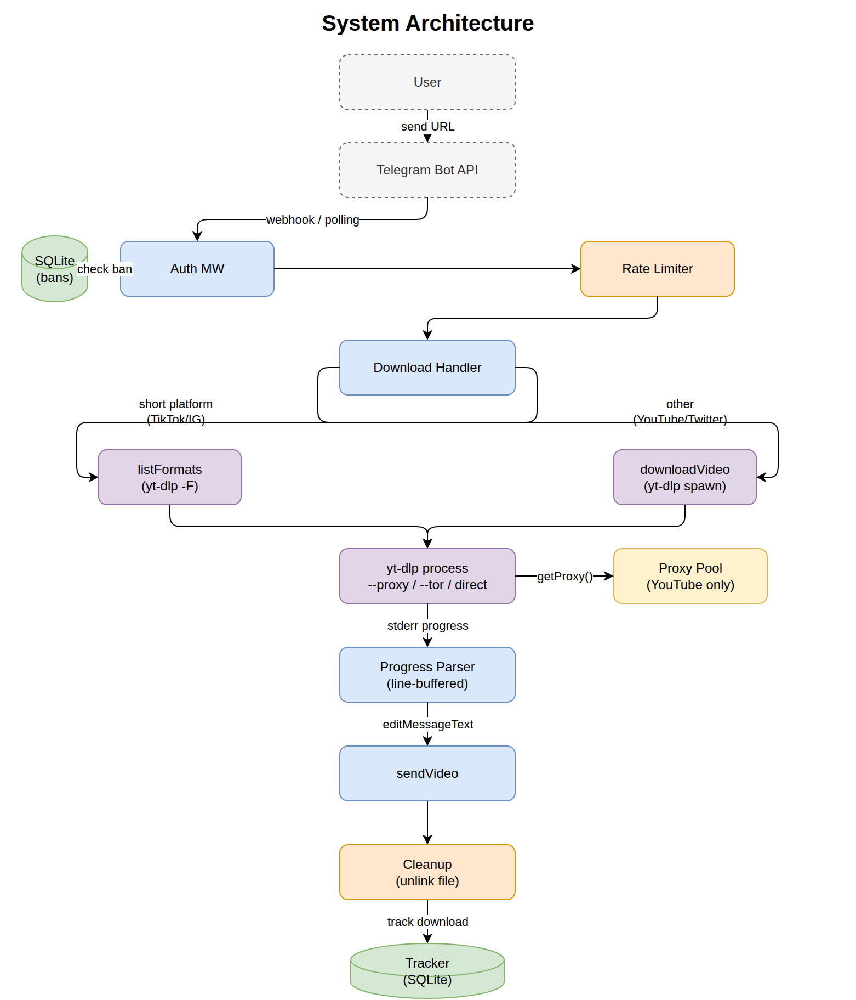

<p align="center">
  
  
</p>

<h1 align="center">📹 Bunny Video Bot</h1>

<p align="center">
  <strong>Autonomous Telegram video downloader. Send a URL, get the file.</strong><br>
  YouTube • Twitter/X • TikTok • Instagram • Snapchat • 1000+ sites<br>
  <em>No watermarks. No stored files. Pure pipe.</em>
</p>

<p align="center">
  
  
  
  
</p>

---

## ✨ Features

- **🔗 Universal Support** — 1000+ platforms via yt-dlp (YouTube, Twitter/X, TikTok, Instagram, Snapchat, Vimeo, and more)
- **🚫 No Watermarks** — TikTok downloads are watermark-free by default; the bot never re-encodes or stamps media
- **💨 Instant Cleanup** — files are deleted from disk milliseconds after delivery; only metadata lives in SQLite
- **🛡️ Authorized Access** — configurable allowlists for users and groups; banned users are silently dropped
- **📊 Admin Dashboard** — 14 admin commands for stats, user management, moderation, and system maintenance
- **🔥 Retry Logic** — automatic retries with exponential backoff for transient failures (timeouts, rate limits)
- **📦 Auto-Compression** — files over Telegram's 50MB upload limit are live re-encoded with ffmpeg (no size cap on the download itself)
- **📦 File Box Share** — videos over the Telegram 50MB cap are uploaded to your self-hosted FileCodeBox and shared as a link and passcode at the downloaded resolution. Chunked uploads pass reverse-proxy body caps (e.g. Cloudflare's 100MB).
- **🔌 YouTube failover** — tries a configured proxy, direct access, up to two tested public proxies, and a reachable Tor SOCKS listener.
- **⚡ aria2 Acceleration** — optional multi-connection download backend for yt-dlp (`ARIA2_ENABLED`); yt-dlp still handles site extraction, aria2 just speeds up the transfer
- **📈 Progress Tracking** — live animated progress bar for both the download and the Telegram upload itself (no more silent "Uploading..." with no feedback)
- **🐳 Docker Ready** — multi-stage Dockerfile with healthcheck and docker-compose for one-command deployment
- **⚡ Bun Native** — built on Bun's zero-config runtime: SQLite, test runner, package manager — all built in

---

## 🚀 Quick Start

### Prerequisites

- **Bun** ≥ 1.3 (or Docker)
- **yt-dlp** with its YouTube challenge solver (install or update with `pip install -U "yt-dlp[default]"`)
- **Deno** ≥ 2.3 for yt-dlp and **FFmpeg** with `ffprobe` for media processing. Docker includes both. [yt-dlp YouTube setup](https://github.com/yt-dlp/yt-dlp/wiki/EJS)
- A Telegram bot token from [@BotFather](https://t.me/BotFather)

### 1. Clone & Configure

```bash
git clone https://github.com/your-org/bun-video-bot.git
cd bun-video-bot
cp .env.example .env
```

Edit `.env` with your credentials:

```env
BOT_TOKEN=61164694...r   # from @BotFather
OWNER_ID=531264503     # your Telegram user ID

# Optional — restrict who can use the bot
ALLOWED_USERS=531264503,987654321
ALLOWED_GROUPS=-1001234567890
```

### 2. Run

```bash
# Native (with the prerequisites installed)
bun install
bun run dev

# Docker (everything included)
docker compose up -d
```

### 3. Use

Open Telegram, find your bot, and send:

```
https://www.youtube.com/watch?v=dQw4w9WgXcQ
https://www.tiktok.com/@user/video/123456789
```

---

## 📋 Commands

### Public

| Command | Description |
|---|---|
| `/start` | Welcome message and instructions |
| `/help` | Supported platforms and usage examples |
| `/about` | Bot version and tech stack info |
| `<video URL>` | Download and receive the file |

### Admin Only

| Category | Command | Description |
|---|---|---|
| **Dashboard** | `/panel` | Command centre overview |
| | `/pulse` | Bot health, uptime, memory, disk |
| | `/stats` | Full statistics with visual breakdown |
| | `/beat` | Live feed of recent downloads |
| | `/top` | Top downloaders leaderboard |
| | `/genre` | Platform breakdown chart |
| **Users** | `/roster` | Paginated user list |
| | `/lookup @user` | Search by username or ID |
| | `/dossier <id>` | Full user profile and history |
| **Moderation** | `/quarantine <id>` | Ban a user |
| | `/pardon <id>` | Unban a user |
| | `/lockup` | List all banned users |
| **System** | `/sweep` | Clean orphaned temp files |
| | `/log` | View recent error logs |

---

## 🏗️ Architecture

<p align="center">
  
</p>

```
User sends URL
  → Auth middleware (check ALLOWED_USERS/GROUPS + ban list)
  → Rate limiter (1 concurrent, 10s cooldown)
  → YouTube route selection (manual proxy → direct → tested public proxies → Tor)
  → yt-dlp download and merge → verify video and audio tracks → prepare playable MP4
  → Progress bar (live Telegram message edits, 2s throttle)
  → sendVideo (file uploaded to Telegram)
  → immediately unlink(filePath) — file gone
  → DB write via serial queue (WAL mode for concurrent reads)
```

```
src/
├── bot.ts              # Grammy bot instance + middleware pipeline
├── config.ts           # Zod-validated .env — fail fast
├── types.ts            # Shared types + classified error codes
├── progress.ts         # Real-time progress bar renderer
├── cleanup.ts          # File lifecycle + crash recovery
├── index.ts            # Entry point — wires everything together
├── db/
│   ├── schema.ts       # SQL schema (WAL mode, 7 indexes)
│   ├── queue.ts        # Serial write queue (SQLite single-writer)
│   └── index.ts        # All query functions
├── middleware/
│   ├── auth.ts         # User/group allowlist + ban enforcement
│   ├── ratelimit.ts    # Per-user concurrency + cooldown
│   ├── adminOnly.ts    # OWNER_ID guard for admin commands
│   └── logger.ts       # Request logging with latency
├── services/
│   ├── downloader.ts   # yt-dlp wrapper with progress + retry
│   ├── proxy.ts        # Speed-tested proxy pool (fastest first) + Tor fallback
│   ├── tracker.ts      # Download audit logging
│   └── admin.ts        # Formatted admin responses
├── handlers/
│   ├── general.ts      # /start /help /about
│   ├── download.ts     # URL → download → send → cleanup
│   └── admin.ts        # 14 admin commands
└── utils/
    ├── url.ts          # Validation + platform detection
    ├── format.ts       # File size, duration, progress bar
    ├── limits.ts       # Constants + file size enforcement
    └── logger.ts       # Pino structured logger
```

---

## 🔧 Configuration

| Variable | Default | Description |
|---|---|---|
| `BOT_TOKEN` | *required* | Telegram bot token from @BotFather |
| `OWNER_ID` | *required* | Telegram user ID of the admin |
| `ALLOWED_USERS` | `""` | Comma-separated user IDs |
| `ALLOWED_GROUPS` | `""` | Comma-separated group IDs (negative) |
| `LOG_LEVEL` | `info` | Pino log level (trace → fatal) |
| `PROXY_URL` | `""` | Manual proxy (takes priority, YouTube only). Supports http://, https://, socks5:// |
| `PROXY_ENABLED` | `true` | Enable public proxy discovery and fallback for YouTube |
| `TOR_ENABLED` | `true` | Try a reachable Tor SOCKS listener as the final YouTube route |
| `TOR_PROXY_URL` | `socks5h://127.0.0.1:9050` | Address of a running Tor SOCKS listener, as seen by the bot |
| `ARIA2_ENABLED` | `false` | Use `aria2c` for direct transfers (requires the `aria2` package). YouTube DASH and HLS transfers use yt-dlp's native downloader |
| `SHAREBOX_URL` | `""` | Self-hosted FileCodeBox base URL; videos over the size threshold are shared via link + passcode |
| `SHAREBOX_PUBLIC_URL` | `""` | Public base URL baked into share links (defaults to `SHAREBOX_URL`) |
| `SHAREBOX_MIN_SIZE_MB` | `49.99` | Files at/above this size go to the file box; smaller send inline |
| `SHAREBOX_TOKEN` | `""` | FileCodeBox token if anonymous upload (openUpload) is disabled |
| `TEMP_DIR` | `/tmp/bun-video-bot` | Temporary download directory |
| `DOWNLOAD_TIMEOUT_SECONDS` | `3600` | Total time for all download attempts and YouTube media preparation |
| `DATABASE_PATH` | `./data/bot.db` | SQLite database location |
| `NODE_ENV` | `development` | Environment (development/production/test) |

### Proxy Resolution Order

Each YouTube request tries `PROXY_URL` when configured, then direct access, up to two public proxies tested against YouTube, and Tor if its SOCKS listener is reachable. Format lookup uses the same route order. Public proxy checks establish basic connectivity, and YouTube may still reject a video request on those routes. Set `PROXY_ENABLED=false` to turn off public proxy discovery.

For Tor, start a SOCKS listener reachable from the bot. In Docker, set `TOR_PROXY_URL` to the listener's address on the container network.

YouTube format selection prefers H.264 video and AAC audio. The bot checks for both tracks before delivery and prepares a compatible MP4 when needed. Set `SHAREBOX_URL` to share over-limit videos at their downloaded resolution. Without a FileCodeBox, the bot attempts compression within Telegram's upload limit.

---

## 🐳 Docker

```bash
# Build
docker build -t bun-video-bot .

# Rebuild and run with the production Compose configuration
mkdir -p data
docker compose -f docker-compose.yml up -d --build

# View logs
docker compose logs -f

# Stop
docker compose down
```

The Docker image includes:
- **Bun 1.3** runtime (slim base, ~130MB)
- **yt-dlp**, the YouTube challenge solver, and **Deno**
- **FFmpeg** and **ffprobe** for merging, verification, and compression
- **aria2** (optional yt-dlp download backend, `ARIA2_ENABLED=true`)
- **Healthcheck** every 30s
- **Auto-restart** on crash (`unless-stopped`)
- **Log rotation** (10MB max, 3 files)

---

## 🧪 Development

```bash
# Install deps
bun install

# Run with hot reload
bun run dev

# Run tests
bun test

# Run tests in watch mode
bun test --watch

# Run with coverage
bun test --coverage

# Typecheck
bun run typecheck

# Build standalone binary
bun run build
```

### Test Coverage

| Area | Tests | Description |
|---|---|---|
| **Config** | 7 | Zod schema validation, defaults, coercion |
| **Database** | 11 | Schema creation, CRUD, write queue |
| **Errors** | 19 | DownloadError class + yt-dlp stderr classification |
| **URL Utils** | 16 | Validation, sanitization, platform detection |
| **Format Utils** | 13 | File size, duration, progress bar rendering |
| **Admin Output** | 6 | Formatted message structure |
| **Limits** | 2 | Free-disk-space guard |
| **Compression** | 2 | Telegram upload-size bitrate planner |
| **File Box** | 9 | Share client: single-shot + chunked, proxy-reject fallback, basename filename regression, resumed-session chunk-size regression |
| **Downloader** | 9 | YouTube format selection, proxy failover, audio verification, and error classification |
| **Total** | **89** | All passing |

---

## 🔒 Security

- **No shell injection** — Subprocess commands use argument arrays; user input is never interpolated into commands
- **URL validation** — rejects non-HTTP schemes (`file://`, `javascript:`, etc.), null bytes, and shell metacharacters
- **Auth middleware** — every message checked against `ALLOWED_USERS`/`ALLOWED_GROUPS` before processing
- **Ban system** — banned users are silently ignored at the middleware level
- **Admin guard** — explicit `requireAdmin()` check on every admin command; owner cannot ban themselves
- **No persisted media** — files deleted in a `finally` block; crash orphans cleaned on startup via `/sweep`

---

## 📄 License

MIT

---

<p align="center">
  <sub>Built with ❤️ using <a href="https://bun.sh">Bun</a> · <a href="https://grammy.dev">grammY</a> · <a href="https://github.com/yt-dlp/yt-dlp">yt-dlp</a></sub>
</p>
